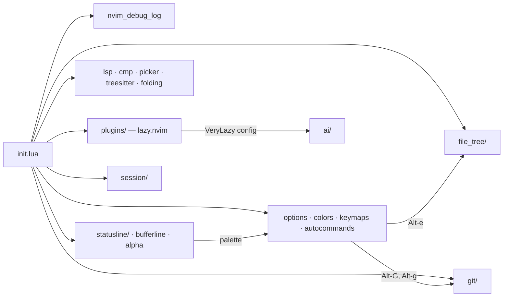
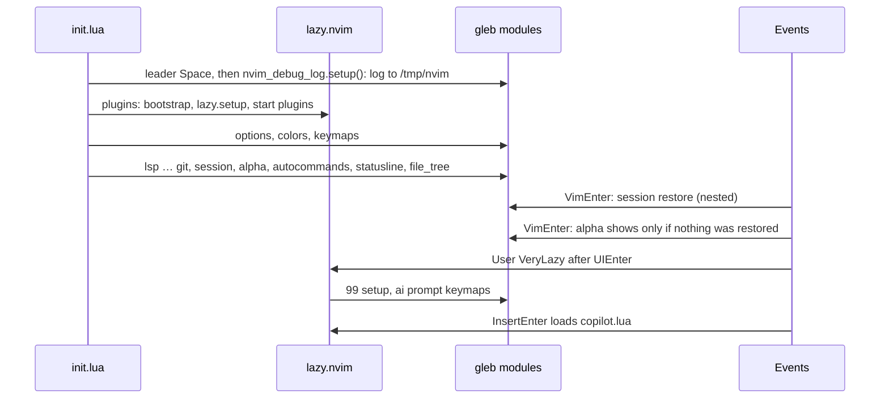
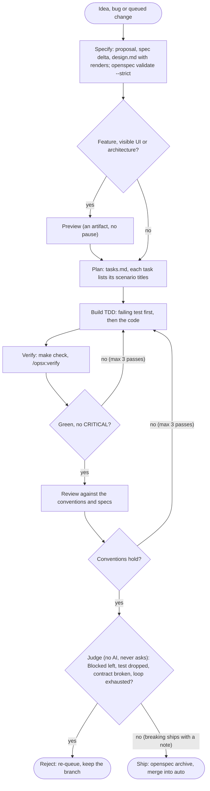
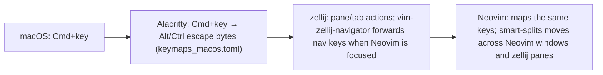

# Architecture

Personal Neovim config (Lua, macOS, one user), run inside zellij in Alacritty. Plugins are managed by
lazy.nvim and pinned in `lazy-lock.json`. Agents maintain it autonomously, so behaviour is pinned down by
OpenSpec specs (`openspec/specs/<capability>/spec.md`) and headless tests, and the user is asked only about
new behaviour, new plugins, core keymaps and escalations.

This page holds what the code cannot show: intent, how the parts relate, why they are built this way, and
the rules every change follows. What a module does is in its code and its spec.

## Principles

- **Spec first.** Each feature module has a capability spec whose scenarios run in a headless child
  Neovim. A change starts by changing the spec.
- **Test first.** Every task starts with a failing test named after its scenario. Screen behaviour is
  pinned by text screenshots ([testing](testing.md)).
- **Plugins and built-ins over custom code.** Custom Lua is glue, or a feature no plugin covers (diff
  preview, language chip, session keys).
- **Degrade, don't crash.** Optional plugins are required with `pcall`, so a missing plugin disables its
  feature instead of breaking startup.
- **Readable and typed.** Idiomatic Lua, small named functions, LuaCATS annotations.
- **Design as text.** UI changes are proposed as fixed-width renders, and the approved render becomes the
  reference screenshot ([workflow](workflow.md#design-renders)).
- **Code is the documentation.** Docs never restate what the code shows (see [rule 10](#10-docs)).

## Module map

Feature code lives in `lua/gleb/<feature>/`; the capability name is the kebab-case module name.

| Module (`lua/gleb/…`) | Role | Spec |
|---|---|---|
| `nvim_debug_log/` | Every message of a session to `/tmp/nvim/`, readable while hidden by `cmdheight=0` | [nvim-debug-log](../openspec/specs/nvim-debug-log/spec.md) |
| `plugins/` | lazy.nvim bootstrap and the one plugin list | |
| `options.lua`, `autocommands.lua`, `colors/` | Editor options, general autocmds, gruvbox-material and its palette | |
| `keymaps.lua` | Global keymaps | [keymaps](../openspec/specs/keymaps/spec.md), [shortcuts](../openspec/specs/shortcuts/spec.md) |
| `actions/` | Typed action catalog shared by feature-owned action lists | |
| `languages/` | Typed language registry whose feature-owned facets keep language support complete | [languages](../openspec/specs/languages/spec.md) |
| `lsp/`, `cmp.lua`, `select/`, editing modules | LSP, completion, treesitter, folding, comments | |
| `git/` | Signs, changes panel, diffview for merges and history, permalinks, AI commit popup | [git](../openspec/specs/git/spec.md) |
| `diff/` | IntelliJ-port diff engine (pure) and owned aligned viewer | [diff](../openspec/specs/diff/spec.md) |
| `file_tree/` | Project tree sidebar, with operations coordinated across pure path policy (`paths.lua`), filesystem and view state (`ops.lua`), and the LSP file-rename lifecycle (`lsp_files.lua`) | [file-tree](../openspec/specs/file-tree/spec.md) |
| `picker/input.lua` | Shared framed text input for feature-owned prompts, preserving picker layout and teardown conventions | [picker](../openspec/specs/picker/spec.md) |
| `references/`, `queries/<lang>/usages.scm` | Find Usages: catalogue-backed usage types captured by language queries, grouped by test scope and folder beside a side-effect-free preview | [references](../openspec/specs/references/spec.md) |
| `session/` | zellij-aware session save and restore | [session](../openspec/specs/session/spec.md) |
| `statusline/`, `bufferline.lua` | Global statusline and tabline from one palette | [statusline](../openspec/specs/statusline/spec.md) |
| `ai/` | 99 prompts backed by the `pi` CLI | [ai](../openspec/specs/ai/spec.md) |
| `debugging/`, `run/`, `testing.lua` | DAP, `:Run`, neotest | |

Most modules are required from `init.lua` after `lazy.setup()` and configure their plugins directly. A
few run from a plugin spec `config` instead, so they load with their plugin (colors transparency, neotest,
`debugging/`, copilot, smart-splits, 99 and `ai/`).

## Startup sequence

Order in `init.lua` is load order, and the code relies on it:

- `nvim_debug_log` is the first module, so it captures messages and errors from everything after it.
- `session` comes before `alpha`, so its `VimEnter` restore runs first and the dashboard skips itself.
- `folding`, `autopairs` and `comments` come after `treesitter`.
- The leader (Space, only a fallback for plugin defaults) is set at the top of `init.lua`, before `lazy.setup()`, so plugin `<leader>` maps bind to it.

## AI maintenance loop

The loop runs locally as Archon workflows in `.archon/workflows/`; how to run it is in
[workflow](workflow.md). OpenSpec holds the specs, the queued changes (`openspec/changes/`, also the list
of known issues) and the project rules (`openspec/config.yaml`). superpowers skills drive each step
(brainstorming, writing-plans, test-driven-development, verification-before-completion). Every change uses
a feature branch forked from `auto` and merges back into `auto`; nothing is pushed.

## Terminal stack

- Each layer has one job: Alacritty only translates, zellij owns panes, tabs and sessions, Neovim owns
  editing. Navigation and resize keys are bound on both zellij and Neovim so they cross pane borders.
- Cmd shortcuts arrive as `<A-…>`. `<C-j>`/`<C-k>` are avoided because they are newline and vertical
  tab to the terminal.
- Shifted special characters (`+`, `_`, …) with Cmd arrive as `<S-D-…>`, not `<A-…>`; map what Neovim
  actually receives.
- macOS offers a chord to the app menu before Alacritty sees it, so the versioned menu-key setup moves
  Quit and Hide off Cmd+Q/Cmd+H before those shortcuts can reach the terminal stack.
- The Alacritty and zellij configs live outside this repo. The [shortcuts spec](../openspec/specs/shortcuts/spec.md)
  is the source of truth for the key table and collisions, and its tests read the real configs.

## Key decisions

- **keymaps**: `<A-e>` toggles the project tree, `<A-G>` the changes panel and `<A-g>` opens the changes
  review; the two sidebars share the left tool-window slot. `gr` opens the Find Usages view. Moved keys
  from the retired neo-tree: `H` → `I` (Show Ignored), `?` → Find Action, `<`/`>` → Alt+E/Alt+Shift+G.
- **ai**: 99 loads on `VeryLazy` to stay out of startup. `pi` runs with `--no-session --thinking low`, so
  each prompt is stateless and cheap. 99 prompts submit on write (`acwrite`), so `<S-CR>` maps to
  `:write` inside them. The commit popup uses a separate local Ollama model.
- **nvim-debug-log**: `:redir` instead of wrapping `vim.notify`, so `echo`, `echom` and errors are caught
  too. The redirection restarts every 2 s, because `:redir` only flushes when it ends. One file per
  session (time and pid), so parallel panes never interleave.
- **session**: the key is zellij session + pane id + cwd, so every pane has its own restore point. Pane ids
  change after zellij resurrection, so a session for the same cwd is the fallback. Only a bare `nvim`
  restores. resession stores layout, never unsaved text, so auto-save keeps buffers written. Restore is
  `nested` so `FileType` and LSP attach fire for restored buffers.
- **file-tree**: one owned sidebar instead of neo-tree, so its rows, keys and colours follow the specs.
  Directory buffers open it, with netrw disabled. Every left panel (project tree, changes panel, diffview)
  is 35 columns wide.
- **git**: the changes panel with the owned diff view reviews changes; diffview stays for merges and
  history. Commit messages come from a local model, the
  prompt goes on stdin to avoid shell escaping, and the diff is cut to 200 lines to keep the model on
  track. `pgw.dev` permalinks use the GitHub URL format.
- **diff**: the right pane is the real file buffer, with window-scoped decorations so its other windows
  stay clean.
- **statusline**: one global statusline. Bar colors are derived from the gruvbox-material palette and
  shared with the bufferline, never hard-coded. The language chip carries LSP health. LSP progress shows
  only after 500 ms with short aliases, and every event is logged so the aliases can grow from real data.
  The Copilot glyph shows only on failure and never loads Copilot before `InsertEnter`.

## Conventions

The rules the AI review checks on every change (`.archon/commands/review.md` cites them by number). Code
that still breaks a rule is a cleanup candidate, queued in `openspec/changes/`, not precedent. Paths are
relative to `lua/gleb/`.

### 1. Module layout

- 1.1 A feature lives in `lua/gleb/<feature>/`, and its `init.lua` only requires its parts in order. One place per feature.
- 1.2 A feature with more than one file is a folder, not a top-level file plus a folder.
- 1.3 Pure logic goes in its own file with no plugin requires, so it is testable without plugins.
- 1.4 A module with an API is `local M = {}` … `return M`; a module that only configures returns nothing.
- 1.5 Module state that tests must reset lives in `M.state` with an `M.reset()`.
- 1.6 `init.lua` order is load order. If a line must come before another, a trailing comment says why, and stays true.
- 1.7 Editor options are set in `options.lua`; a feature sets only options it owns (e.g. fold options).
- 1.8 Tests live in `tests/<layer>/<capability>/` ([testing](testing.md)).
- 1.9 A feature exposes its actions from `<feature>/actions.lua`; shortcut keys live outside action definitions.
- 1.10 Language knowledge lives only in `languages/<name>/`; features register and consume it through the registry facets.

### 2. Plugin specs and wiring

- 2.1 Every plugin is declared once in `plugins/plugins.lua`, with a comment saying what it is for.
- 2.2 Plugin configuration lives in a `gleb` module, not inline in the spec; the spec points to it or calls it from `config`. Keeps it testable.
- 2.3 Use `opts = {}` when a plugin only needs `setup(opts)`.
- 2.4 A plugin not needed at startup is lazy-loaded (`event`, `ft`, `cmd`, `keys`), its config required from the spec.
- 2.5 Code that runs on every redraw never requires a lazy plugin; check `package.loaded` or `pcall`.
- 2.6 Spec fields are spelled right: lazy.nvim silently ignores unknown keys.
- 2.7 No plugin that duplicates a built-in or another plugin, unless the spec says why.

### 3. Keymaps

- 3.1 Shortcut keys live only in `settings/keymap.json`; each feature exposes configurable behavior from its `actions.lua`.
- 3.2 Use `vim.keymap.set`; no `nvim_set_keymap`, no Vimscript `map`.
- 3.3 Mapping descriptions are derived from action metadata as `"<Category>: <Title>"` (a title that starts with its category does not repeat it), so `:map` and pickers name them consistently.
- 3.4 Options are `{ silent = true, desc = … }`; `noremap` is already the default; `remap = true` only when the rhs is a mapping.
- 3.5 The rhs is a function reference, a named local function or `<Cmd>…<CR>`; no `:…<CR>` strings, no long anonymous functions.
- 3.6 One mode per behaviour: `x` for visual maps, not both `v` and `x`.
- 3.7 Cmd shortcuts arrive as `<A-…>` from Alacritty; a Cmd chord with no binding anywhere arrives as `<D-…>` (kitty keyboard protocol). Window moves use smart-splits so they cross into zellij ([terminal stack](#terminal-stack)).
- 3.8 No new `<leader>` assignments in `settings/keymap.json`; spec-retained plugin-window defaults are exempt. Cmd shortcuts instead. Core shortcut changes need user approval.
- 3.9 No deprecated APIs.

### 4. Naming

- 4.1 Files and folders are `snake_case.lua`; capabilities are the kebab-case module name.
- 4.2 `require` paths use dots.
- 4.3 Locals and functions are `snake_case`; tunable constants are `UPPER_SNAKE` at the top of the file.
- 4.4 Augroups are `gleb_<feature>` or `gleb_<feature>_<purpose>`.
- 4.5 Highlight groups are PascalCase with an area prefix; names built from data are sanitized.
- 4.6 User commands are PascalCase nouns or verbs.

### 5. Types (LuaCATS)

- 5.1 Every function exported on `M` has `---@param` and `---@return`.
- 5.2 Module state and option tables get a `---@class`, constant lists a `---@type`.
- 5.3 Plugin types come from lazydev; never redefine them.

### 6. Errors and optional plugins

- 6.1 A module that configures a plugin starts with `local ok, mod = pcall(require, "<plugin>")` and returns early on failure; specs test it ("Missing … is tolerated").
- 6.2 `pcall` commands that may fail harmlessly (`colorscheme`, `tabclose`, `treesitter.start`).
- 6.3 Async callbacks go through `vim.schedule` and check that the window or buffer is still valid and the request still current.
- 6.4 External commands run with `vim.system` and an argument list, check the exit code, and show the failure.
- 6.5 Timers and jobs stop when idle and on exit.

### 7. Autocmds

- 7.1 `nvim_create_autocmd` with a `group` from `nvim_create_augroup(name, { clear = true })`, so re-sourcing doesn't duplicate it.
- 7.2 No Vimscript `augroup` blocks.
- 7.3 A callback longer than a few lines is a named local function.
- 7.4 `nested = true` only when the callback opens buffers that need their own events, with a comment saying so.

### 8. Notifications and UI

- 8.1 `vim.notify(msg, vim.log.levels.X)`, never `print`: INFO for progress and success, ERROR with the error text.
- 8.2 Messages are short, sentence-case, no trailing period: `"Pushing..."`, `"Push failed"`.
- 8.3 Report success only after checking the result.
- 8.4 Background work is silent.
- 8.5 One-key prompts use `nvim_echo` with a highlight group.
- 8.6 Floating windows use `border = "rounded"`.
- 8.7 Colors come from the gruvbox-material palette helpers, never hard-coded hex.
- 8.8 A change with visible UI includes a Current render and Proposed renders ([design renders](workflow.md#design-renders)).
- 8.9 Borders are always drawn in full; hints and counters never sit on a border; the title (and query) is the only border text; hints go right-aligned in grey on the last inner row below a joined rule.

### 9. Comments and style

- 9.1 A file that holds a design starts with a comment: what, why, how to tune.
- 9.2 Comments explain why, not what. No commented-out code, no stale TODOs.
- 9.3 Comments match the code.
- 9.4 Format with stylua (`make fmt`), lint with selene (`make lint`).
- 9.5 Icon strings are never empty: Nerd Font glyphs get lost in edits, so check with `grep -n '= ""'`.

### 10. Docs

- 10.1 Docs never duplicate code logic: no component lists, flows or file:line walkthroughs the code
  already shows. They hold intent, cross-module relationships, decisions and how to operate.
- 10.2 Behaviour lives in `openspec/specs/**`, planned work and known issues in `openspec/changes/**`.
- 10.3 Markdown goes only in `README.md`, `docs/architecture.md`, `docs/workflow.md`, `docs/testing.md`,
  `docs/CLAUDE.md` (the root `CLAUDE.md` and `AGENTS.md` are symlinks to it), `openspec/specs/**` and
  `openspec/changes/**` (tool-generated `.claude/`, `.pi/` and `.archon/commands/` prompts aside). Every
  file in `docs/` is linked from `README.md`, and every relative link resolves. The AI review flags
  violations.
