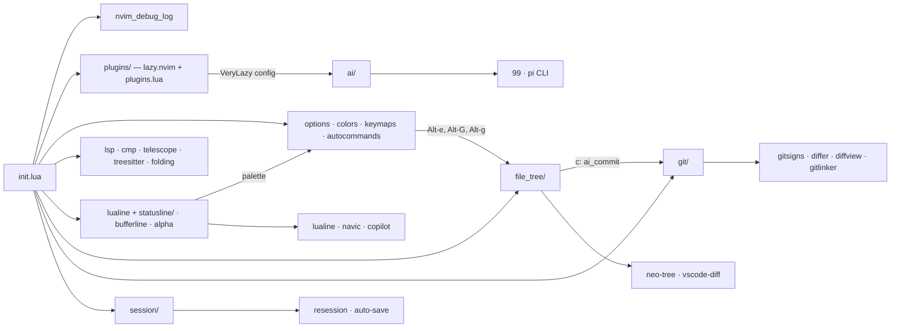
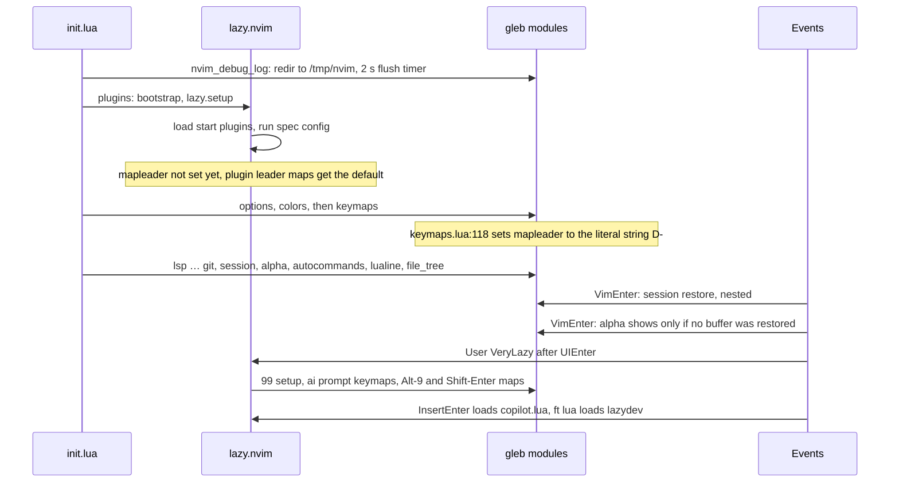
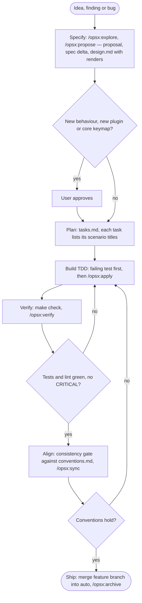

# Architecture

Personal Neovim config (Lua, Neovim 0.12, macOS, one user). Plugins are managed by lazy.nvim and pinned in
`lazy-lock.json`. Agents maintain it autonomously, so behaviour is pinned down by OpenSpec specs and
headless tests, and the user is only asked about new behaviour, new plugins, core keymaps and escalations.

- Conventions the consistency gate enforces: [conventions.md](conventions.md)
- How to sketch UI as text: [../design-renders.md](../design-renders.md)
- Known issues: [../../openspec/findings.md](../../openspec/findings.md)

## Principles

- **Spec first.** Each feature module has a capability spec (`openspec/specs/<capability>/spec.md`) whose
  scenarios run in a headless child Neovim. A change starts by changing the spec.
- **Test first.** Every task starts with a failing test (mini.test child Neovim). Screen-level behaviour is
  pinned by text screenshots under `tests/screenshots/` (being built; `make check` runs everything,
  `make render` prints the child screen as text).
- **Plugins and built-ins over custom code.** Custom Lua is glue, small named functions, or a feature no
  plugin covers (diff preview, language chip, session keys).
- **Degrade, don't crash.** Optional plugins are required with `pcall`, so a missing plugin disables its
  feature instead of breaking startup.
- **Readable and typed.** Idiomatic Lua, small named functions, LuaCATS annotations where they help.
- **Design as text.** UI changes are proposed as fixed-width renders, and the approved render becomes the
  reference screenshot.

## Module map

| Module (`lua/gleb/…`) | Role | Key plugins | Spec |
|---|---|---|---|
| `nvim_debug_log/` | Redirect all messages to `/tmp/nvim/<time>_<pid>.txt` | none | [nvim-debug-log](nvim-debug-log.md) |
| `plugins/` | Bootstrap lazy.nvim, the plugin spec list | lazy.nvim | n/a |
| `options.lua`, `autocommands.lua` | Editor options, general autocmds, format on save | none | n/a |
| `colors/` | gruvbox-material, highlight overrides, palette, transparency | gruvbox-material, transparent.nvim, nvim-colorizer | n/a |
| `keymaps.lua` | Global keymaps, leader keys | smart-splits, telescope | [keymaps](keymaps.md) |
| `lsp/`, `cmp.lua`, `select/` | LSP servers, diagnostics, completion, code-action picker | nvim-lspconfig, mason, none-ls, blink.cmp | n/a |
| `telescope.lua`, `treesitter.lua`, `folding/`, `comments/`, `autopairs.lua`, `indentline.lua` | Editing | telescope, nvim-treesitter, nvim-ufo, ibl | n/a |
| `git/` | Signs, diff viewers, permalinks, AI commit popup | gitsigns, differ, diffview, vscode-diff, gitlinker, nui | [git](git.md) |
| `file_tree/` | neo-tree, git status with diff preview | neo-tree, vscode-diff | [file-tree](file-tree.md) |
| `session/` | zellij-aware session save and restore | resession, auto-save | [session](session.md) |
| `lualine.lua`, `statusline/` | Global statusline, language chip, LSP progress | lualine, nvim-navic, copilot.lua | [statusline](statusline.md) |
| `ai/` | Pi provider and prompt keymaps for 99 | ThePrimeagen/99, `pi` CLI | [ai](ai.md) |
| `debugging/`, `run/`, `testing.lua` | DAP, `:Run`, neotest | nvim-dap, dap-ui, neotest | n/a |
| `bufferline.lua`, `alpha-nvim.lua`, `project.lua` | Buffer tabs, dashboard, project root | bufferline, alpha, project.nvim | n/a |

### Dependency map

Most feature modules are required from `init.lua` after `lazy.setup()` and configure their plugins
directly. A few are run from a plugin spec `config` instead: `colors/transparency.lua`, `testing.lua`,
`git/vscode_diff.lua`, and the 99 setup that loads `ai/` (`lua/gleb/plugins/plugins.lua:29,187,255,323`).

## Startup sequence

Lazy triggers in `plugins.lua`: `VeryLazy` (99), `InsertEnter` and `:Copilot` (copilot.lua), `ft=lua`
(lazydev), `ft=markdown` (render-markdown), `:TSC` (tsc.nvim), `BufRead Cargo.toml` (crates.nvim).
Every other plugin is a start plugin and loads inside `lazy.setup()`.

Ordering facts the code relies on:

- `nvim_debug_log` is first so it captures messages from everything after it (`init.lua:4`).
- `session` is required before `alpha-nvim`, so its `VimEnter` restore runs first and alpha skips itself
  when buffers were restored (`init.lua:24`, `lua/gleb/session/init.lua:39-45`).
- `folding`, `autopairs` and `comments` come after `treesitter` (`init.lua:15-17`).
- `lualine` comes late and sets `laststatus=3` after its setup (`lua/gleb/lualine.lua:96`).

**Known ordering bug.** `init.lua:9` says the mapleader must be set before lazy.nvim, but `keymaps.lua` is
required after `plugins` (`init.lua:6`), and it sets `vim.g.mapleader = "<D->"` on its last lines
(`lua/gleb/keymaps.lua:118`). That value is the literal 4-character string `<D->`, not a key. `keymaps.lua`
also needs smart-splits and telescope at load time (`keymaps.lua:9,105`), so the fix is to set the leader at
the top of `init.lua`, not to move the file. The same applies to `init.lua:8`, which says colors must load
before lazy.nvim but loads after it (lazy uses `install.colorscheme` only while installing).

## AI maintenance loop

- **OpenSpec** holds the specs, change proposals and project rules (`openspec/config.yaml`). The
  `/opsx:*` commands live in `.claude/commands/opsx/`.
- **superpowers** skills drive the agent at each step: brainstorming while specifying, writing-plans for
  tasks, test-driven-development while building, verification-before-completion before claiming done.
- **Gates**: the escalation gate (rules in `openspec/config.yaml` `context`), the test gate (`make check`
  and the scenario tests), the verify gate (`/opsx:verify` with no CRITICAL findings) and the consistency
  gate (the rules in [conventions.md](conventions.md)).
- **Git**: each change uses a feature branch forked from `auto` and merges back into `auto`.

## Capability docs

| Capability | Doc | Spec |
|---|---|---|
| keymaps | [keymaps.md](keymaps.md) | [spec](../../openspec/specs/keymaps/spec.md) |
| ai | [ai.md](ai.md) | [spec](../../openspec/specs/ai/spec.md) |
| nvim-debug-log | [nvim-debug-log.md](nvim-debug-log.md) | [spec](../../openspec/specs/nvim-debug-log/spec.md) |
| file-tree | [file-tree.md](file-tree.md) | [spec](../../openspec/specs/file-tree/spec.md) |
| git | [git.md](git.md) | [spec](../../openspec/specs/git/spec.md) |
| session | [session.md](session.md) | [spec](../../openspec/specs/session/spec.md) |
| statusline | [statusline.md](statusline.md) | [spec](../../openspec/specs/statusline/spec.md) |
