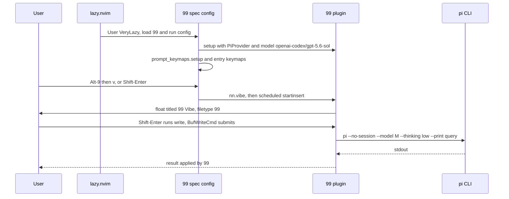

# ai

> Spec: [openspec/specs/ai/spec.md](../../openspec/specs/ai/spec.md) · [Overview](README.md) · [Conventions](conventions.md) · [Renders](../design-renders.md)

## Purpose

AI-assisted editing with [ThePrimeagen/99](https://github.com/ThePrimeagen/99) backed by the `pi` CLI:
search, vibe (free prompt) and visual (prompt over a selection). A custom provider runs `pi` ephemerally,
and `<S-CR>` submits inside a 99 prompt. The AI commit message popup is a separate feature, see [git](git.md).

## Components

| File | Role |
|---|---|
| `lua/gleb/plugins/plugins.lua:317-359` | 99 lazy spec: `event = "VeryLazy"`, `setup` with provider + model (`:325-328`), menu and entry keymaps (`:331-357`) |
| `lua/gleb/ai/pi_provider.lua` | `PiProvider`: metatable over `require("99").Providers.BaseProvider` (`:3`), builds the `pi` command (`:5-16`), name and default model (`:18-24`) |
| `lua/gleb/ai/prompt_keymaps.lua` | `setup()`: augroup `99PromptKeymaps` (cleared), `FileType 99` maps `<S-CR>` to `<Cmd>write<CR>` buffer-locally in `n` and `i` |
| `tests/ai/*_spec.lua` | Busted-style tests for the provider and the prompt keymaps |

## Flow



## Key decisions

- **Lazy on `VeryLazy`**: 99 and its telescope dependency stay out of the startup path; the entry maps
  exist only after that event (spec: "Keymaps exist after VeryLazy").
- **Ephemeral, cheap runs**: `--no-session` and `--thinking low` (`pi_provider.lua:7-12`) so each prompt is
  stateless and fast.
- **Inherit the base provider**: only `_build_command`, `_get_provider_name` and `_get_default_model` are
  overridden; everything else falls through `__index` to `BaseProvider`.
- **Submit = write**: 99 prompts are `buftype=acwrite` and submit on `BufWriteCmd`, so `<S-CR>` maps to
  `<Cmd>write<CR>` (`prompt_keymaps.lua:4`). Being buffer-local, it overrides the global `<S-CR>` vibe map
  inside prompts.
- **One-key menu** on `<A-9>` (`plugins.lua:336-344`): `getchar()` reads `s` or `v`; any other key is ignored.

## Known issues

From [findings.md](../../openspec/findings.md):

- Low: the model string is hard-coded twice (`plugins.lua:327`, `pi_provider.lua:23`).

Observed while writing this doc:

- The 99 menu and entry keymaps live in an anonymous `config` function in `plugins.lua` (`:323-358`), not in
  `lua/gleb/ai/`. This breaks the "small, named functions" rule in `docs/CLAUDE.md` and keeps them out of
  reach of unit tests.
- `pi_provider.lua:1` requires `99` at module load, so the provider can only be required after 99 is on the
  runtime path.
- Two AI backends: 99 uses `pi`, the git commit popup uses `ollama run tavernari/git-commit-message:sp_commit_mini`
  (`git/ai_commit.lua:41`). Model choice is not shared.
- `tests/ai/*_spec.lua` use plenary `describe/it`; the debug-log tests already use mini.test, so these are
  part of the migration.

## Current render

> Approximate: derived from the code, not captured. Regenerate with `make render` once available.

**Current A**: `100x3`, excerpt: last 3 rows, Normal mode, after `<A-9>` (waiting for a key, `cmdheight=0`
so the message takes the last row)

```text
  2       vim.keymap.set("v", "<A-9>", visual_prompt, { desc = "99: Visual" })
  3       vim.keymap.set("v", "<S-CR>", visual_prompt, { desc = "99: Visual" })
99> [s]earch [v]ibe: █
```

Highlights: `99> [s]earch [v]ibe: ` [Question]

**Current B**: `100x30`, Insert mode, after `<A-9>` `v` in `lua/gleb/plugins/plugins.lua` line 354. The
float is 2/3 of the width and 1/3 of the height, centered, with a key legend on its last row
(`99/lua/99/window/init.lua`, `create_centered_window`, `create_window_legend`).

```text
▎◆ plugins.lua        ◆ keymaps.lua
   14         local actions = { s = nn.search, v = nn.vibe }
   13         if actions[key] then
   12           enter_prompt(actions[key])
   11         end
   10       end
    9
    8       local function vibe_prompt()
    7         enter_prompt(nn.vibe)
    6       end
    5            ╭──────────────────────────── 99 Vibe ─────────────────────────────╮
    4       local│  1 █                                                             │
    3         ent│                                                                  │
    2       end  │                                                                  │
    1            │                                                                  │
  354       vim.k│                                                                  │
    1       vim.k│                                                                  │
    2       vim.k│                                                                  │
    3       vim.k│                                                                  │
    4     end,   │                                                                  │
    5   },       │ :w=submit q=cancel                                               │
    6            ╰──────────────────────────────────────────────────────────────────╯
    7   -- Markdown rendering
    8   {
    9     "MeanderingProgrammer/render-markdown.nvim",
   10     opts = { file_types = { "markdown" } },
   11     ft = { "markdown" },
   12   },
   13
 INSERT  ⎇ auto  ~ 1                                                                  ✗ 0 ▲ 0  ◆ 99
```

Highlights: border [FloatBorder] · title ` 99 Vibe ` [FloatTitle] · legend `:w` `q` [WarningMsg], `submit`
`cancel` [Comment]. The legend shows 99's own `:w=submit`; this config adds `<S-CR>` on top.
