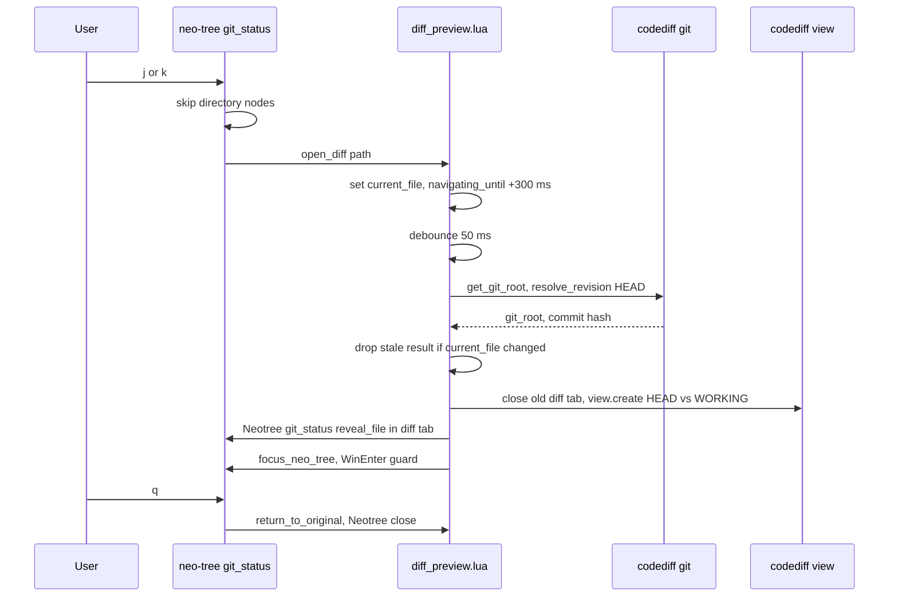

# file-tree

> Spec: [openspec/specs/file-tree/spec.md](../../openspec/specs/file-tree/spec.md) · [Overview](README.md) · [Conventions](conventions.md) · [Renders](../design-renders.md)

## Purpose

neo-tree as the file explorer with two sources: `filesystem` and `git_status`. In `git_status`, moving
with `j`/`k` previews each changed file in one reusable side-by-side diff tab (vscode-diff), and the tree
can stage, commit (AI message popup) and push.

## Components

| File | Role |
|---|---|
| `lua/gleb/file_tree/init.lua` | `neo_tree.setup`: sources, left window 35 wide, common mappings, filesystem options, git_status mappings (`j`, `k`, `<cr>`, `<space>`, `c`, `P`, `q`) |
| `lua/gleb/file_tree/diff_preview.lua` | Diff tab state (`original_tab`, `diff_tab`, `current_file`, `navigating_until`), 50 ms debounce, focus guard, uses `codediff.core.git` and `codediff.ui.view` |
| `lua/gleb/git/ai_commit.lua` | Commit message popup used by `c` (see [git](git.md)) |
| `lua/gleb/keymaps.lua:52-90` | `smart_toggle_neotree`: `<A-e>` filesystem, `<A-G>` git_status |
| `lua/gleb/plugins/plugins.lua:201-209,252-258` | neo-tree v3.x and vscode-diff specs |
| `tests/file_tree/diff_preview_spec.lua` | Existing diff preview tests (plenary style) |

## Flow



## Key decisions

- **One reusable diff tab**: each preview closes the previous diff tab and creates a fresh one
  (`diff_preview.lua:75-87`), so there is never more than one.
- **Debounce plus stale check**: rapid `j`/`k` only renders the last file (`DEBOUNCE_MS = 50`, `:17`), and
  async git results for an older file are dropped (`:54`).
- **Focus guard**: for 300 ms after a keypress, focus that lands in a diff window is pulled back to the
  tree (`NAVIGATION_WINDOW_MS`, `:18`, `:91-106`), so `j`/`k` keep working.
- **vscode-diff internal API** instead of its explorer: `mode = "standalone"` with HEAD vs `WORKING`
  (`:61-68`). neo-tree stays the only file list.
- **Same width everywhere**: neo-tree, differ, diffview and the vscode-diff explorer all use a 35-column
  left panel.
- **Show everything in filesystem**: dotfiles and gitignored files are listed (`init.lua:182-186`), the
  tree follows the current file and hijacks netrw (`open_current`).
- **`pcall(require, "neo-tree")`** so the module is safe without the plugin (`init.lua:1-4`).

## Known issues

From [findings.md](../../openspec/findings.md):

- Medium: diff preview never clears `state.original_tab`, so it returns to a stale tab.
- Git-side issues of the `git_status` tree (substring match in `<space>` staging, `c` committing on
  `# No staged changes`/`# Error` lines without checking the exit code, `gr`/`c` shadowing global maps)
  are listed under [git](git.md).
- Test gaps: "should create a new tab" asserts `>=`, and "should track original tab" checks its own
  assignment.

Observed while writing this doc:

- `expander_collapsed`, `expander_expanded`, `folder_closed`, `folder_open`, `folder_empty`,
  `git_status.symbols.unmerged` and the diagnostics symbols are empty strings (`init.lua:120-147`), so
  neo-tree shows no expanders or folder icons from this config.
- The comment at `init.lua:79` says "commit with floating input (Alt+C for AI)"; no `<A-C>` mapping
  exists. `c` always runs the AI popup.
- `bufferline.lua` offsets the tabline for filetype `NvimTree` (`bufferline.lua:56`), not `neo-tree`, so
  the bufferline is not shifted over the tree.
- `git_close` (`q`) and `<cr>` call `close_all_diffs`, which never resets `original_tab` or the focus
  guard autocmd (only `reset()` does, `diff_preview.lua:183-192`).

## Current render

> Approximate: derived from the code, not captured. Regenerate with `make render` once available.
> neo-tree change symbols (added/modified) use neo-tree defaults; drawn here as `+` / `~`.

**Current, tab 2 of 2 (diff tab)**: `100x14`, Normal mode, after `<A-G>` then `j` onto
`lua/gleb/lualine.lua`; `lualine.lua` is staged, `keymaps.lua` is modified, `docs/design-renders.md` is
untracked

```text
 ◆ keymaps.lua         ◆ lualine.lua                                                           1  2 
 ~/.config/nvim                    │  59 local copilot = {          │  59 local copilot = {         
 ├ ■ docs                          │  60   require("gleb.statusl…   │  60   require("gleb.statusl…  
 │ └ ? ◆ design-renders.md         │  61   color = { fg = require…  │  61   color = { fg = require… 
 └ ■ lua/gleb                      │  62 }                          │  62 }                         
   ├ ~ ◆ keymaps.lua               │  63                            │  63                           
   └ ~» ◆ █ualine.lua              │  64 lualine.setup({            │  64 lualine.setup({           
                                   │  65   options = {              │  65   options = {             
                                   │  66     icons_enabled = true,  │  66     icons_enabled = true, 
                                   │  67     theme = "gruvbox-mat…  │  67     theme = require("gleb…
                                   │  68     component_separators…  │  68     component_separators… 
                                   │  69     section_separators =…  │  69     section_separators =… 
                                   │  70     disabled_filetypes =…  │  70     disabled_filetypes =… 
 NORMAL  ⎇ auto  + 1 ~ 1                                                             ✗ 0 ▲ 0  ◆ lua 
```

Highlights: ` ◆ lualine.lua ` [BufferLineBufferSelected] on `bar_sel` · tree names [NeoTreeGitModified] /
[NeoTreeGitUntracked] (`use_git_status_colors`) · `»` and `?` [NeoTreeGitStatusSymbol] · line 67 left
[DiffDelete]/[DiffChange], right [DiffAdd]/[DiffChange] (vscode-diff groups) · `│` [WinSeparator] (`bg3`)

**Current, tab 1 of 2 (original tab)**: `100x6`, excerpt: top rows, Normal mode, after `<A-e>` in
`lua/gleb/keymaps.lua`

```text
 ◆ keymaps.lua         ◆ lualine.lua                                                           1  2 
 ~/.config/nvim                    │    2 -- Smart neo-tree toggle: switch source, close if same & f
 ├ ■ docs                          │    1 local function smart_toggle_neotree(source)
 ├ ■ lua                           │┃ 54  █ local current_win = vim.api.nvim_get_current_win()
 │ └ ■ gleb                        │    1   local current_buf = vim.api.nvim_win_get_buf(current_win
 │   └ ◆ keymaps.lua               │    2   local current_ft = vim.api.nvim_get_option_value("filety
```

Highlights: `┃` [GitSignsChange] · `54` [CursorLineNr] · `~/.config/nvim` [NeoTreeRootName] · revealed
`keymaps.lua` row [NeoTreeCursorLine]
