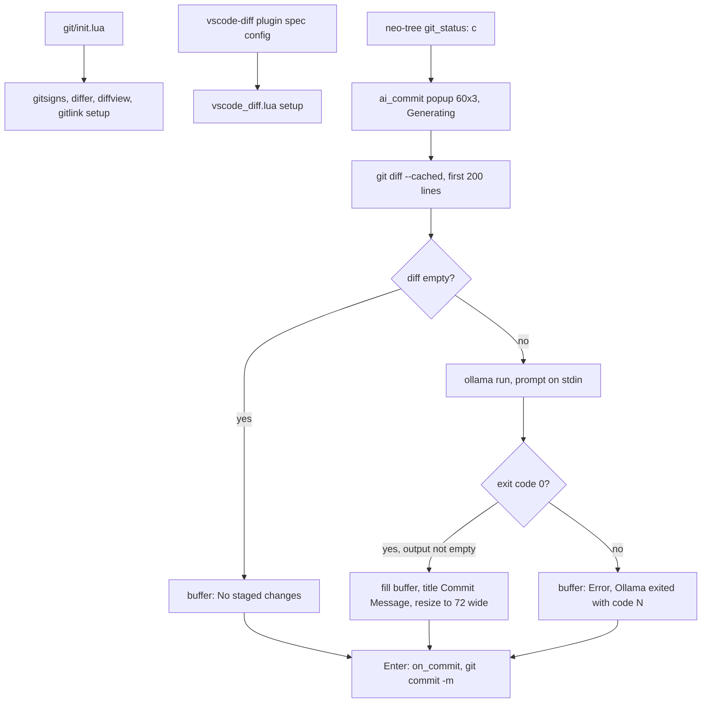

# git

> Spec: [openspec/specs/git/spec.md](../../openspec/specs/git/spec.md) · [Overview](README.md) · [Conventions](conventions.md) · [Renders](../design-renders.md)

## Purpose

Git integration from `lua/gleb/git/`: gutter signs (gitsigns), three diff viewers kept side by side for
comparison (differ.nvim as the main one, diffview.nvim, vscode-diff), `:Gitlink` permalinks, and an
Ollama-generated commit message popup used by the neo-tree `git_status` tree.

## Components

| File | Role |
|---|---|
| `lua/gleb/git/init.lua` | Loads gitsigns, differ, diffview, gitlink in that order |
| `lua/gleb/git/gitsigns.lua` | Signs `┃` (add/change) and a delete glyph; numhl, linehl, word diff, blame off |
| `lua/gleb/git/differ.lua` | differ.nvim: split layout, context 3, word deep diff, left tree panel 35 wide |
| `lua/gleb/git/diffview.lua` | diffview.nvim: `diff2_horizontal`, `diff3_mixed` merges, panel 35 wide, view and panel maps incl. `<leader>c*` conflict maps |
| `lua/gleb/git/vscode_diff.lua` | vscode-diff (`codediff`) setup; loaded from the plugin spec `config` (`plugins.lua:252-258`), not from `init.lua` |
| `lua/gleb/git/gitlink.lua` | gitlinker setup (`pgw.dev` as GitHub type) and `:Gitlink` with range |
| `lua/gleb/git/ai_commit.lua` | `show_commit_input(on_commit)`: nui popup, staged diff, `ollama run tavernari/git-commit-message:sp_commit_mini` |
| `lua/gleb/file_tree/init.lua:79-87` | Caller: neo-tree `git_status` `c` runs `git commit -m` with the confirmed message |
| `lua/gleb/keymaps.lua:87` | `<A-g>` runs `:Differ` |
| `lua/gleb/plugins/plugins.lua:234-262` | Specs: gitsigns, mini.diff, differ (`make go-build`), diffview, vscode-diff, gitlinker |

## Flow



The `none` and `err` edges into `Enter` are the High finding below: the placeholder text is committed.

## Key decisions

- **Three viewers on purpose**: diffview is "kept alongside differ for comparison" (`init.lua:3`) and
  vscode-diff powers the neo-tree preview. `<A-g>` opens differ; `<A-G>` opens the old neo-tree flow.
- **Same panel geometry**: every viewer has a 35-column left tree panel, matching neo-tree
  (`differ.lua:6-15`, `diffview.lua:24-27`, `vscode_diff.lua:8-12`).
- **Optional plugins are tolerated**: gitsigns, differ, diffview and vscode-diff use `pcall(require, …)`
  and return early.
- **Local model for commit messages**: Ollama via `jobstart` with the prompt on stdin "to avoid shell
  escaping issues" (`ai_commit.lua:38-80`); stderr is dropped as spinner noise and the exit code decides
  success. The diff is cut at 200 lines "to prevent model confusion" (`:8-13`).
- **Popup grows to content**: 72 columns (commit width) capped at 80% of `columns`, height = wrapped line
  count capped at 10 (`:141-164`).
- **`pgw.dev` uses GitHub URL format** via a gitlinker host callback (`gitlink.lua:4-6`).

## Known issues

From [findings.md](../../openspec/findings.md):

- High: neo-tree `c` commits even on `# No staged changes` / `# Error` lines and reports "Committed:"
  without checking the exit code.
- High: neo-tree `<space>` staging uses a substring match (`a.lua` matches `aa.lua`) and compares a
  cwd-relative path with git-root-relative paths.
- High (keymaps): `mapleader` is the literal string `<D->`, so diffview `<leader>c*` maps bind to the
  wrong keys.
- Medium: an AI commit with empty output leaves the title stuck on "Generating..." (`ai_commit.lua:65`).
- Medium: `gitlink.lua` requires gitlinker without `pcall`, so startup errors if the plugin is missing.
- Low: mini.diff and gitsigns both show hunk signs; `git_status` `gr`/`c` shadow the global LSP
  references and copy maps.

Observed while writing this doc:

- `vscode_diff.lua:7` says "Explorer disabled - we use neo-tree", but the block configures the explorer
  (left, 35, tree); nothing disables it.
- The gitsigns `delete`/`topdelete` sign text is a Nerd Font glyph; other icon slots in the config are
  empty strings (see [statusline](statusline.md), [file-tree](file-tree.md)).
- The AI commit uses Ollama, unrelated to the Pi provider in [ai](ai.md); its model string is
  hard-coded in `ai_commit.lua:41`.

## Current render

> Approximate: derived from the code, not captured. Regenerate with `make render` once available.

**Current, AI commit popup (generating)**: `100x9`, Normal mode, `c` pressed in the `git_status` tree,
Ollama still running (popup 60x3 inside a rounded border, centered)

```text
 ◆ keymaps.lua         ◆ lualine.lua                                                           1  2 
 ~/.config/nvim                    │    3 -- Window navigation (seamless with Zellij via smart-spli
 └ ■ lua/gleb      ╭───────────────────── LL Generating... ─────────────────────╮+L
   ├ ~ ◆ keymaps.lu│█                                                           │ (to avoid termina
   └ ~» ◆ lualine.l│                                                            │s").move_cursor_le
                   │                                                            │s").move_cursor_do
                   ╰────────────────── <CR> ✓ │ i edit │ q ✗ ───────────────────╯s").move_cursor_up
                                   │    3 kmap("n", "<C-l>", require("smart-splits").move_cursor_ri
 NORMAL  ⎇ auto  + 1 ~ 1                                                             ✗ 0 ▲ 0  ◆ lua 
```

**Current, AI commit popup (result)**: `100x5`, excerpt: rows around the popup, Normal mode, Ollama exited 0,
resized to 72x1

```text
                                   │    1 -- Cmd+J sends Alt+j, Cmd+K sends Alt+k (to avoid termina
             ╭──────────────────────────── Commit Message ────────────────────────────╮
             │█eat(statusline): render language chip caps                             │
             ╰──────────────────────── <CR> ✓ │ i edit │ q ✗ ─────────────────────────╯
                                   │    1 kmap("n", "<A-j>", require("smart-splits").move_cursor_do
```

Highlights: body [Normal] (`winhighlight = Normal:Normal`) · border, title and footer [FloatBorder] ·
text [gitcommitSummary] (`filetype=gitcommit`)

**Current, differ (`<A-g>`)**: `100x12`, Normal mode, split layout, `lua/gleb/lualine.lua` selected

```text
 ◆ keymaps.lua         ◆ lualine.lua                                                           1  2 
 ~/.config/nvim                g? │ 64 lualine.setup({            │ 64 lualine.setup({            
 Staged                           │ 65   options = {              │ 65   options = {              
 └ ■ lua/gleb                     │ 66     icons_enabled = true,  │ 66     icons_enabled = true,  
   └ ◆ █ualine.lua   M  +1 -1     │ 67     theme = "gruvbox-mat…  │ 67     theme = require("gleb.…
 Unstaged                         │ 68     component_separators…  │ 68     component_separators…  
 └ ■ lua/gleb                     │ 69     section_separators =…  │ 69     section_separators =…  
   └ ◆ keymaps.lua   M  +4 -2     │ 70     disabled_filetypes =…  │ 70     disabled_filetypes =…  
 Untracked                        │ 71     always_divide_middle…  │ 71     always_divide_middle…  
 └ ■ docs                         │ 72   },                       │ 72   },                       
   └ ◆ design-renders.md  ?       │ 73   sections = {             │ 73   sections = {             
 NORMAL  ⎇ auto  + 1 ~ 1                                                             ✗ 0 ▲ 0  ◆ lua 
```

Highlights: section titles [differPanelHeader] · `+1` [DiffAdd]-like and `-1` [DiffDelete]-like counts
(differ groups, approximate) · word-level change on line 67 from `deep_diff.granularity = "word"`

**Current, gitsigns in a buffer**: `100x4`, excerpt: window rows, Normal mode, line 106 changed and line 107
added

```text
┃   1 kmap("n", "<A-r>", vim.lsp.buf.rename, opts)
┃ 107 █map("n", "<A-R>", vim.lsp.buf.references, opts)
    1 
    2 -- Diagnostics
```

Highlights: `┃` [GitSignsChange] on line 106 and [GitSignsAdd] on line 107 · no blame virtual text
(`current_line_blame = false`)
