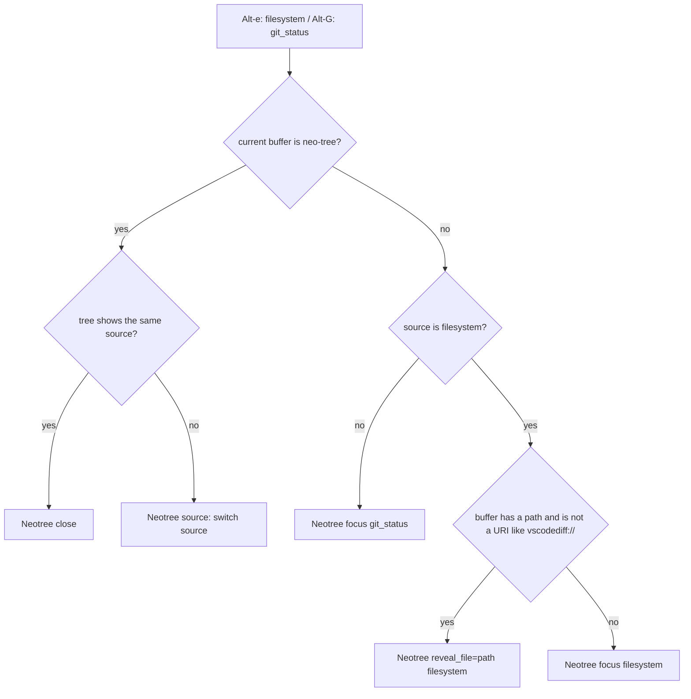

# keymaps

> Spec: [openspec/specs/keymaps/spec.md](../../openspec/specs/keymaps/spec.md) · [Overview](README.md) · [Conventions](conventions.md) · [Renders](../design-renders.md)

## Purpose

Global editor keymaps: window navigation and resizing (zellij-aware), jump list, buffer close, insert and
visual editing helpers, entry points for the file tree, Differ and live grep, LSP and diagnostics
navigation, and the leader keys. The physical keys come from macOS Cmd combos that Alacritty sends as Alt
or Ctrl sequences (see [KEYBINDINGS.md](../KEYBINDINGS.md)).

## Components

| File | Role |
|---|---|
| `lua/gleb/keymaps.lua` | All global maps, one shared `opts = { noremap = true, silent = true }` (`:1`), `kmap = vim.keymap.set` (`:2`) |
| `lua/gleb/keymaps.lua:53-80` | `smart_toggle_neotree(source)`: switch, close or focus the neo-tree source |
| `init.lua:9` | Loads keymaps after `gleb.plugins`, `gleb.options` and `gleb.colors` |
| `mrjones2014/smart-splits.nvim` (`plugins.lua:286-297`) | Window move and resize across Neovim and zellij panes, `at_edge = "stop"` |
| Elsewhere | Feature maps live with their feature: `comments/init.lua:3-4` (`<A-/>`), `folding/init.lua:10-14`, 99 maps in `plugins.lua:354-357` (see [ai](ai.md)), neo-tree maps in `file_tree/init.lua` |

## Flow

`<A-e>` (filesystem) and `<A-G>` (git_status) both go through `smart_toggle_neotree`:



## Key decisions

- **One file, one options table.** Every map in `keymaps.lua` is `noremap` + `silent` (`:1`), which the
  spec asserts.
- **smart-splits for `<C-h>/<A-j>/<A-k>/<C-l>` and `<A-H/J/K/L>`** (`:9-12`, `:26-29`) so the same keys
  cross zellij pane borders. `<A-j>/<A-k>` instead of `<C-j>/<C-k>` avoids terminal conflicts (`:8`).
- **URI buffers are not revealed** (`:70-71`): neo-tree can't parse `vscodediff://` and similar names, so it
  falls back to `Neotree focus filesystem`.
- **`<A-g>` is Differ, `<A-G>` the old neo-tree git status** (`:86-90`), kept side by side so both flows can
  be compared.
- **`gr` goes to Telescope references** (`:105`), not `vim.lsp.buf.references`.

## Known issues

From [findings.md](../../openspec/findings.md):

- High: `vim.g.mapleader = "<D->"` is a literal string, and it is set after lazy.nvim loads
  (`keymaps.lua:118`). Plugin `<leader>` maps (diffview `<leader>c*`) bind to the wrong keys.
- Medium: visual `<A-j>/<A-k>` and `<C-CR>` are mapped in both `v` and `x` (`:42-43`, `:49-50`, `:97-98`),
  so `x` wins. Visual `J`/`K` (`:47-48`) override built-ins.
- Medium: `vim.diagnostic.goto_next/prev` are deprecated in 0.11, and the `border` option has no effect
  (`:109-115`).
- Low: `docs/KEYBINDINGS.md` is stale (`<A-g>` is now `:Differ`, neo-tree git status moved to `<A-G>`).
- Low: neo-tree git_status `gr`/`c` shadow the global LSP references and copy maps.

Observed while writing this doc:

- `init.lua:9` says "mapleader keymap must be before lazy.nivm", but `gleb.plugins` (which runs
  `lazy.setup`) is required on `init.lua:6`. The fix can't be "move keymaps.lua up": it requires
  `smart-splits` and `telescope.builtin` at the top level (`:9-12`, `:105`), which need lazy.nvim's runtime
  path. Set `vim.g.mapleader` in `init.lua` before `require("gleb.plugins")` instead.
- No map in `keymaps.lua` has a `desc`, so they are unnamed in `:map` listings (the 99 maps do have one).
- `<C-q>` runs the built-in `:bdelete` (`:32`), which closes every window showing the buffer. The bufferline
  close command uses vim-bbye `Bdelete!` (`bufferline.lua`), which keeps the layout.
- `lua/gleb/debugging/keybindings.lua` would map `<A-J>/<A-H>/<A-L>` to dap steps and collide with the
  resize maps. It is not loaded today (`debugging/init.lua:1` is commented out).

## Current render

> Approximate: derived from the code, not captured. Regenerate with `make render` once available.

**Current**: `100x16`, Normal mode, after `<A-e>` from `lua/gleb/keymaps.lua` line 83, focus in neo-tree

```text
▎◆ keymaps.lua        ◆ init.lua           ◆ plugins.lua
 ~/.config/nvim                    │    3 end
   .claude                         │    2
   docs                            │    1 -- Neo-tree (Cmd+E/G via Alt escape sequences from Alacrit
   lua                             │  83  kmap("n", "<A-e>", function()
   │ gleb                          │    1   smart_toggle_neotree("filesystem")
   │ │ ai                          │    2 end, opts)
   │ │ colors                      │    3 -- <A-g>: differ.nvim (new). <A-G>: old neo-tree git_statu
   │ │ file_tree                   │    4 kmap("n", "<A-g>", ":Differ<cr>", opts)
   │ │ git                         │    5 kmap("n", "<A-G>", function()
   │ │ ◆ █eymaps.lua               │    6   smart_toggle_neotree("git_status")
   │ │ ◆ lualine.lua               │    7 end, opts)
   │ └ ◆ options.lua               │    8
   openspec                        │    9 -- Telescope
   ◆ init.lua                      │   10 kmap("n", "<A-F>", ":Telescope live_grep<cr>", opts)
 NORMAL  ⎇ auto                                                                 ✗ 0 ▲ 0  ◆ neo-tree
```

Highlights: tree row `keymaps.lua` [NeoTreeCursorLine] · `│` [WinSeparator] (`bg3`) · tree background
[NeoTreeNormal] = `bg0` (`colors/gruvbox-material/init.lua`) · selected tab [BufferLineBufferSelected]

Notes on the render: folder icons and expanders are not drawn because they are empty strings in
`file_tree/init.lua:120-126`. The bufferline spans the tree column because its offset targets the
`NvimTree` filetype, not `neo-tree` (`bufferline.lua`). The chip shows `neo-tree` because the statusline
follows the current window.
