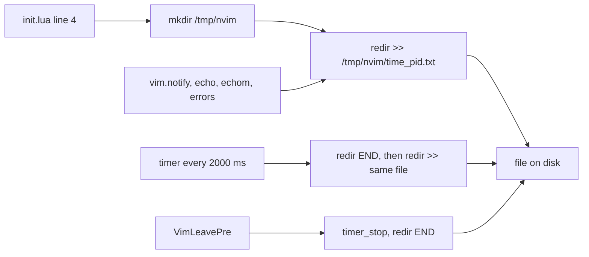

# nvim-debug-log

> Spec: [openspec/specs/nvim-debug-log/spec.md](../../openspec/specs/nvim-debug-log/spec.md) · [Overview](README.md) · [Conventions](conventions.md) · [Renders](../design-renders.md)

## Purpose

Writes every Neovim message of a session to a file under `/tmp/nvim/`, so messages hidden by `cmdheight=0`
or lost before the UI starts can be read later with `tail -f`. It is the first thing `init.lua` loads, so it
also catches errors from the rest of the config.

## Components

| File | Role |
|---|---|
| `init.lua:4` | `require("gleb.nvim_debug_log")` before anything else |
| `lua/gleb/nvim_debug_log/init.lua` | `mkdir /tmp/nvim` (`:1`), path `/tmp/nvim/<os.time()>_<pid>.txt` (`:3`), `redir >>` (`:6`), 2000 ms repeating flush timer (`:8-15`), `VimLeavePre` shutdown (`:17-22`) |
| `lua/gleb/nvim_debug_log/tests/debug_log_spec.lua` | mini.test child-Neovim tests for capture, flush and shutdown |

## Flow



## Key decisions

- **Load first** (`init.lua:3-4`): messages from every later module, including startup errors, land in the
  log.
- **`:redir` instead of wrapping `vim.notify`**: one mechanism catches `vim.notify`, `:echo`, `:echom` and
  error messages.
- **Restart the redirection every 2 s**: `:redir` output is only flushed when it ends, so ending and
  restarting it makes the file readable while the session runs.
- **One file per session**, named by start time and pid, so parallel Neovim panes never interleave.

## Known issues

From [findings.md](../../openspec/findings.md):

- Medium: the 2 s flush runs `:redir END` and cuts off any other active `:redir`.
- Low: `/tmp/nvim` logs (and `/tmp/nvim-lsp-progress.log` from the statusline) are never cleaned up.
- Test gap: the tests wait 3000 ms against a 2000 ms flush, which is flaky.

Observed while writing this doc:

- The `VimLeavePre` autocmd (`init.lua:17`) has no augroup, so re-sourcing the module adds a second one and
  a second timer.
- The module has no `M` table or setup function: requiring it is the side effect, which makes it hard to
  turn off or test in isolation.
- The tests live in `lua/gleb/nvim_debug_log/tests/`, while other tests live under `tests/<feature>/`.

## Current render

> Approximate: derived from the code, not captured. Regenerate with `make render` once available.

No UI. The output is the log directory and file.

**Current A**: `ls /tmp/nvim` with two Neovim panes running

```text
1791813302_48213.txt
1791813877_51907.txt
```

**Current B**: `tail /tmp/nvim/1791813302_48213.txt` after a write, a commit and push from the neo-tree git
status, and a write with no LSP attached. Each message starts on a new line, as `:redir` writes it.

```text

"lua/gleb/keymaps.lua" 119L, 4130B written
Committed: docs(architecture): add keymaps design doc
Pushing...
Pushed successfully
"README.md" 9L, 764B written
[LSP] Format request failed, no matching language servers.
```

The messages come from `file_tree/init.lua:85-97` (`Committed:`, `Pushing...`, `Pushed successfully`) and
the format-on-save autocmd in `autocommands.lua:37-44`.
