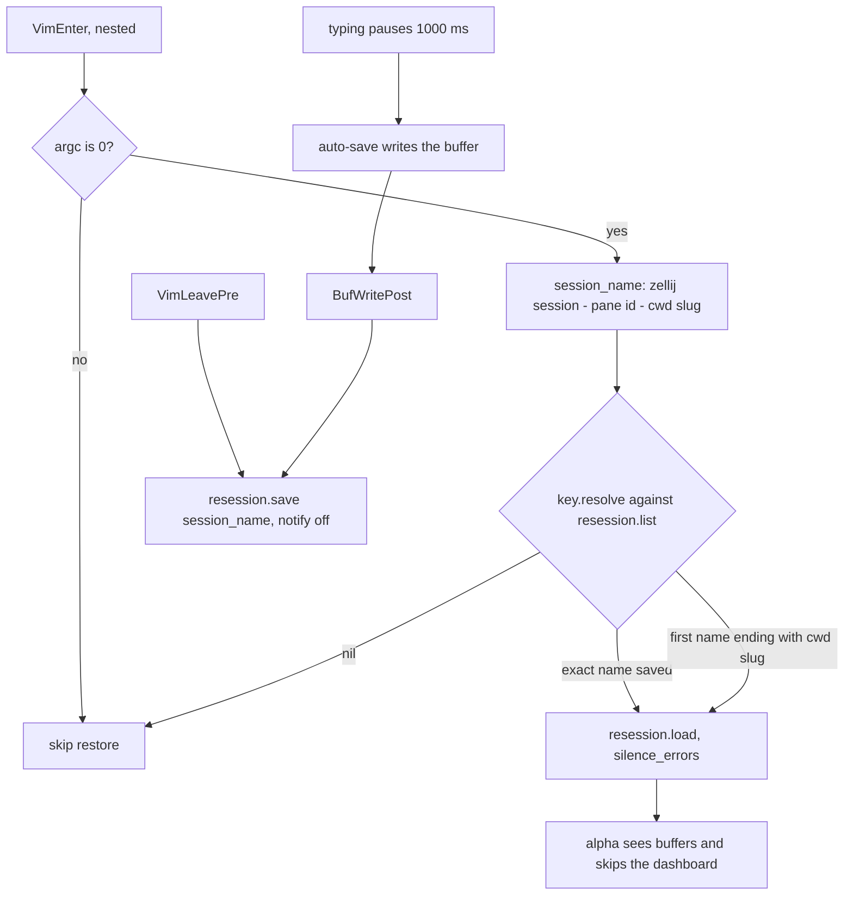

# session

> Spec: [openspec/specs/session/spec.md](../../openspec/specs/session/spec.md) · [Overview](README.md) · [Conventions](conventions.md) · [Renders](../design-renders.md)

## Purpose

Zellij-aware session recovery on top of [resession.nvim](https://github.com/stevearc/resession.nvim). Each
Neovim pane saves its layout under a key built from the zellij session, pane id and cwd, and a bare `nvim`
restores it. [auto-save.nvim](https://github.com/okuuva/auto-save.nvim) keeps buffers written, because
resession stores paths and layout, never unsaved text.

## Components

| File | Role |
|---|---|
| `lua/gleb/session/key.lua` | Pure helpers with no plugin dependency: `slugify` (`:7-9`), `session_name` (`:12-19`), `resolve` (`:23-34`) |
| `lua/gleb/session/init.lua` | `pcall(require, "resession")` guard (`:11-14`), `resession.setup` with autosave off (`:33-35`), augroup `gleb_session` with `VimEnter` restore (`:41-45`) and `BufWritePost`/`VimLeavePre` save (`:47-50`) |
| `lua/gleb/plugins/plugins.lua:265-282` | resession spec, and auto-save with a `condition` (normal buffers, not `gitcommit`/`gitrebase`) and a 1000 ms debounce |
| `init.lua:24` | Loaded before `gleb.alpha-nvim` so its `VimEnter` runs first and a restored buffer makes the dashboard skip itself |
| `lua/gleb/autocommands.lua:46-63` | Disables format-on-save during auto-save writes (`AutoSaveWritePre/Post`) |
| `lua/gleb/session/tests/key_spec.lua` | Tests for `key.lua` |

## Flow



## Key decisions

- **Key = zellij session + pane id + cwd** (`key.lua:12-19`): every pane gets its own restore point.
  Outside zellij it degrades to `no-zellij-0-<cwd>`.
- **cwd fallback** (`key.lua:27-32`): pane ids change after zellij resurrection, so a session for the same
  cwd from another pane is reused.
- **Only bare `nvim` restores** (`init.lua:24-26`): `nvim file` and piped input keep their normal startup.
- **Saves driven by autocmds, not resession's timer** (`init.lua:34`, `:47-50`): a save on each write and on
  exit.
- **`nested = true`** on `VimEnter` (`init.lua:43`) so `FileType` and LSP attach fire for restored buffers.
- **Auto-save instead of saving buffer contents** (`init.lua:8-9`): resession can't restore unsaved text.

## Known issues

From [findings.md](../../openspec/findings.md):

- High: the fallback match is suffix-only (`/foo/bar` matches `/baz/foo/bar`) and is not most-recent
  despite the comment (`init.lua:5` says "most recent", `key.lua:28-31` returns the first match).
- High: `nvim file` skips restore but still saves on exit, which overwrites the pane session with one file.

Observed while writing this doc:

- Every auto-save write fires `BufWritePost`, so the session is saved after each typing pause, not only on
  manual `:w`.
- The "most recent" part of the finding holds only by accident: `resolve` takes the first match, and
  `resession.list()` returns names newest first because of resession's default
  `load_order = "modification_time"`. Nothing in this config sets or tests that, so the spec's "first entry"
  wording hides the dependency.
- Empty sessions are saved too: a pane that quits with no file buffers stores `"buffers": []`. If it is the
  newest for the cwd, the fallback restores nothing.
- auto-save is configured in `plugins.lua`, not in `lua/gleb/session/`, although the spec puts it in this
  capability.

## Current render

> Approximate: derived from the code, not captured. Regenerate with `make render` once available.

No UI of its own. Sessions are JSON files in `stdpath("data")/session` (resession `config.dir = "session"`):

**Current A**: `ls -l ~/.local/share/nvim/session` (size, mtime, name; zellij session `blossoming-triceratops`)

```text
 198 B  15 Jun 17:06  blossoming-triceratops-5-%Users%hlebbeladzed%.config%nvim.json
1.1 kB  15 Jun 17:10  blossoming-triceratops-7-%Users%hlebbeladzed%.config%nvim.json
 600 B  15 Jun 16:27  blossoming-triceratops-8-%Users%hlebbeladzed%.config%nvim.json
 658 B  23 Jun 23:07  blossoming-triceratops-8-%Users%hlebbeladzed%Work%finteqhub%svc%sauron.json
```

Started in pane 9 with cwd `~/.config/nvim`, there is no exact match. `resession.list()` sorts by
modification time, newest first (resession default `load_order = "modification_time"`), so `resolve`
returns the pane-7 session. The pane-5 session holds `"buffers": []`.

**Current B**: `100x4`, excerpt: first and last rows, Normal mode, after a bare `nvim` restored pane 7

```text
▎◆ keymaps.lua        ◆ init.lua             ◆ spec.md
  1   local opts = { noremap = true, silent = true }
    1 local kmap = vim.keymap.set
 NORMAL  ⎇ auto                                                                    ✗ 0 ▲ 0  ◆ lua
```

Highlights: selected tab [BufferLineBufferSelected] · `◆` in the chip [StatuslineLang_lua]
