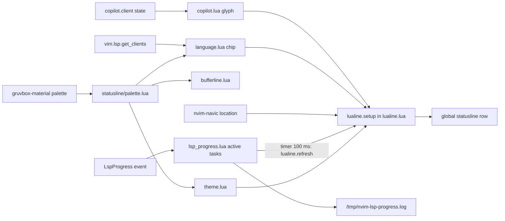

# statusline

> Spec: [openspec/specs/statusline/spec.md](../../openspec/specs/statusline/spec.md) · [Overview](README.md) · [Conventions](conventions.md) · [Renders](../design-renders.md)

## Purpose

One global lualine statusline (`laststatus=3`) colored from the gruvbox-material palette. It shows mode,
git branch and diff, the navic breadcrumb, delayed LSP progress, a Copilot failure glyph, diagnostics and
an LSP-health language chip. The bufferline (top row) uses the same palette so both bars match.

## Components

| File | Role |
|---|---|
| `lua/gleb/lualine.lua` | lualine setup: sections, separators, disabled filetypes; sets `laststatus=3` after setup (`:96`) |
| `lua/gleb/statusline/palette.lua` | Bar colors derived from `gleb.colors.gruvbox-material.palette` (`LIFT`, `WARM`), mode accents, `ok`/`err` |
| `lua/gleb/statusline/theme.lua` | lualine theme table built from the palette |
| `lua/gleb/statusline/language.lua` | Language chip: caps + devicons logo + filetype; defines `StatuslineLang*` groups, redefines on `ColorScheme` |
| `lua/gleb/statusline/lsp_progress.lua` | `LspProgress` autocmd: active task table, 500 ms delay, label aliases, 100 ms refresh timer, log to `/tmp/nvim-lsp-progress.log` |
| `lua/gleb/statusline/copilot.lua` | Glyph shown only when Copilot is loaded and broken |
| `lua/gleb/bufferline.lua` | Consumes `gleb.statusline.palette` for the top bar |
| `lua/gleb/plugins/plugins.lua:212-223` | lualine and nvim-navic specs (`lsp.auto_attach`, `depth_limit = 5`) |

## Flow



## Key decisions

- **Global statusline**: `laststatus=3` is set after `lualine.setup` (`lualine.lua:94-96`), one bar for
  the whole tab.
- **Colors derived, never hard-coded**: the bar is `bg0` blended 5% toward orange and brightened 2%
  (`palette.lua:13-19`) so it sits just above the editor background. The bufferline shares it.
- **No separators**: component and section separators are empty (`lualine.lua:69-70`) for a flat look.
- **Language chip carries LSP health**: left cap color is green with a running client, red without
  (`language.lua:96`). `STYLE` picks the body layout (`language.lua:14`, default `logo_name`).
- **Progress without flicker**: tasks show only after 500 ms (`lsp_progress.lua:11`), and raw server text
  is mapped to short aliases (`:17-26`). Every event is logged so aliases can grow from real data.
- **Copilot is silent when healthy**: the glyph shows only on failure, and the component never requires
  Copilot before it loads on `InsertEnter` (`copilot.lua:8-12`).
- **Diff hidden in narrow windows**: `cond = hide_in_width` (`winwidth(0) > 80`, `lualine.lua:6-8`).

## Known issues

From [findings.md](../../openspec/findings.md):

- High: an LSP progress task without an `end` event spins forever, and the 100 ms timer never stops.
- Medium: `string.format("%d", pct)` may error on fractional percentages (`lsp_progress.lua:115`).
- Medium: the chip highlight name `StatuslineLang_<filetype>` is not sanitized for filetypes with `-`
  (`language.lua:66`).
- Low: `/tmp/nvim-lsp-progress.log` is never cleaned up; the `ColorScheme` autocmd has no augroup
  (`language.lua:37`); `inactive_sections` are dead with `laststatus=3`; the diff `cond` uses the current
  window width.

Observed while writing this doc:

- `CAP_LEFT` and `CAP_RIGHT` are empty strings (`language.lua:24-25`). With `STYLE = "logo_name"` (no
  dot), the chip shows no LSP health at all, and the "rounded pill" in the spec is not drawn.
- `GLYPH` is an empty string (`copilot.lua:6`), so the Copilot failure indicator never shows anything.
  The spec copies this: the scenarios "copilot glyph shown when disabled" and "copilot glyph shown on
  warning" expect `component()` to return `""`, the same as the hidden scenarios.
- The comment at `lualine.lua:94` says "make bufferline global"; the line sets the statusline
  (`laststatus`).

## Current render

> Approximate: derived from the code, not captured. Regenerate with `make render` once available.

**Current**: `100x1`, excerpt: statusline row, Normal mode, `lua/gleb/keymaps.lua` in a git repo with
changes, lua_ls attached and indexing for more than 500 ms, 2 errors and 1 warning

```text
 NORMAL  ⎇ auto  + 3 ~ 1 - 2  smart_toggle_neotree                   ⠹ indexing 42%  ✗ 2 ▲ 1  ◆ lua 
```

Highlights: ` NORMAL ` [lualine_a_normal] green bg, `bg0` text, bold · branch, diff, navic, progress,
diagnostics on the bar [lualine_b_normal] / [lualine_c_normal] · `✗ 2` [DiagnosticError] · `▲ 1`
[DiagnosticWarn] · `◆` [StatuslineLang_lua] · ` ◆ lua ` [StatuslineLangText] on `chip_bg` · caps
[StatuslineLangCapOk] / [StatuslineLangEdge] exist but draw nothing (empty glyphs).

**Current, insert mode**: `100x1`, excerpt: statusline row, Insert mode, same buffer, no LSP client,
no diagnostics

```text
 INSERT  ⎇ auto  + 3 ~ 1 - 2                                                         ✗ 0 ▲ 0  ◆ lua 
```

Highlights: ` INSERT ` [lualine_a_insert] blue bg · no progress shown · left cap would be
[StatuslineLangCapError] red, but it is empty, so this row looks the same as a healthy one.
