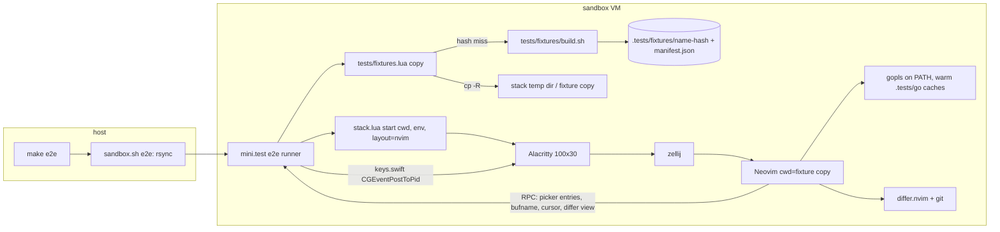

# Design

## Context

See proposal.md (Why). Facts that shape the design, from the code:

- The e2e stack (`tests/shortcuts/stack.lua` `M.start`, frontend `tests/e2e/alacritty.lua`) starts one Alacritty (160x45) -> zellij -> Neovim per test file, layout Neovim left + `cat` right, Neovim's cwd = the runner's cwd (the checkout). It passes an allow-list of env vars with a temp `HOME`, and the helpers sandbox gives Neovim a temp `XDG_DATA_HOME` with only `lazy/` and `site/` linked, so mason's gopls is not visible: gopls must be on `PATH`.
- `gr` = `telescope.builtin.lsp_references` (`lua/gleb/keymaps.lua`), `include_declaration` left at its default (true), `path_display = { "smart" }`.
- Cmd+G -> `\eg` -> `<A-g>` -> `:Differ` (shortcuts table). differ is set up in `lua/gleb/git/differ.lua` (split layout, panel left 35 wide, tree listing). differ exposes `require("differ").active_view()` and a winbar `hunk K/N` counter; local diffs need no sidecar.
- `tests/e2e/build.sh` already caches a build by `shasum` in `.tests/`; `rsync` to the guest excludes `/.tests/`, so fixtures are built in the guest.
- `tests/sandbox/sandbox.sh` pins Neovim, zellij and Alacritty to the host's versions from release builds ("no Homebrew bottles"). The host has go 1.27.1 and gopls v0.21.1.
- `keys.swift` posts letters, `[`, `]`, Return, Escape: every key of both workflows exists.
- Brainstorm with the options and research (codediff.nvim's seed-repo test pattern, gopls readiness, Homebrew vs pinned): run artifact `brainstorm.md`.

## Goals / Non-Goals

**Goals:**
- Fixtures that are generated, cached by content and copied per test; nothing committed as a repo.
- The two workflows driven by real key events and observed over RPC, with predicate waits only.
- Warm e2e stays within ~10 s of today's ~13 s.

**Non-Goals:**
- Asserting pixels or colors of the picker or differ (screen layer, later).
- Asserting gopls progress in the statusline (`fix-lsp-progress-stuck-task` is queued).
- A shared stack across e2e files.

## Renders

The change adds no UI. The renders show what the e2e workflows drive and assert, per option.

**Current**: `100x20`, excerpt: Alacritty window of today's e2e stack, Normal mode, empty buffer, cwd = repo checkout, zellij panes Neovim (left) and `cat` (right), no LSP, no git changes

```text
█                                                │
~                                                │
~                                                │
~                                                │
~                                                │
~                                                │
~                                                │
~                                                │
~                                                │
~                                                │
~                                                │
~                                                │
~                                                │
~                                                │
~                                                │
~                                                │
~                                                │
~                                                │
 NORMAL  ⎇ auto                                  │
                                                 │
```

Highlights: [Normal], [lualine_a_normal], [lualine_b_normal]. Only the shortcut recorders run here;
no workflow touches a real project.

**Proposed A** (recommended): one stack per workflow file, Neovim-only zellij layout, Alacritty sized
`100x30`, cwd = fresh fixture copy. Render 1 of 2: `100x30`, Neovim pane, Insert mode in the Telescope
prompt, `gomod` fixture, `internal/money/money.go`, gopls attached, after `g r`

```text
 ◆ money.go                                                                                         
package money                                                                                       
                                                                                                    
import "fmt"                                                                                        
                                                                                                    
// Format renders cents as a dollar amount, e.g. 1999 -> "$19.99".                                  
func Format(cents int) string {                                                                     
╭ Results ──────────────────────────────────────╮╭ Grep Preview ───────────────────────────────────╮
│ internal/money/money.go:6:6:func Format(cents ││ package report                                  │
│ internal/money/money_test.go:9:13:  if got := ││                                                 │
│ billing/invoice.go:18:9:    return money.Form ││ import "example.com/fixture/internal/money"     │
│ billing/invoice.go:24:22:   lines = append(l  ││                                                 │
│> report/summary.go:11:30:   return "total: "  ││ // Summary is the one-line report footer.       │
│                                               ││ func Summary(total int) string {                │
│                                               ││         return "total: " + money.Format(total)  │
│                                     5 / 5     ││ }                                               │
╰───────────────────────────────────────────────╯│                                                 │
╭ LSP References ───────────────────────────────╮│                                                 │
│ █                                             ││                                                 │
╰───────────────────────────────────────────────╯╰─────────────────────────────────────────────────╯
                                                                                                    
                                                                                                    
                                                                                                    
                                                                                                    
                                                                                                    
                                                                                                    
                                                                                                    
 INSERT  ⎇ main                                                                     ✗ 0 ▲ 0  ● ◆ go 
                                                                                                    
```

Highlights: [TelescopeSelection] on the `report/summary.go` row, [TelescopePreviewLine] on the call
line. Typing `summary` narrows the list to that one entry. The test asserts the entry list
(5 = declaration + 4 call sites, from `manifest.json`), then Return lands on `report/summary.go`
at the manifest's line and column.

Render 2 of 2: `100x30`, Neovim pane, Normal mode, `dirty` fixture, after Cmd+G, `]f` to `b.txt`, `]c`
to its second hunk, diff window focused

```text
 ■ dirty            file 2/5│ b.txt                                                ◆ hunk 2/2 
▾ ■ Staged                  │  1 alpha                    │  1 alpha                            
    a.txt               +1  │  2 beta                     │  2 beta (unstaged edit 1)           
    d.txt            +1 -1  │  3 gamma                    │  3 gamma                            
▾ ■ Changes                 │  4 delta                    │  4 delta                            
  > b.txt            ~2     │ ··· 10 unchanged lines ···  │ ··· 10 unchanged lines ···          
    d.txt               ~1  │ 15 omicron                  │ 15 omicron                          
  ▾ ■ lib                   │ 16 pi                       │ 16 pi                               
      c.lua             ~1  │ 17 rho                      │█17 rho (unstaged edit 2)            
▾ ■ Untracked               │ 18 sigma                    │ 18 sigma                            
    new.txt             +3  │ 19 tau                      │ 19 tau                              
                            │                             │                                     
                            │                             │                                     
                            │                             │                                     
                            │                             │                                     
                            │                             │                                     
                            │                             │                                     
                            │                             │                                     
                            │                             │                                     
                            │                             │                                     
                            │                             │                                     
                            │                             │                                     
                            │                             │                                     
                            │                             │                                     
                            │                             │                                     
                            │                             │                                     
                            │                             │                                     
                            │                             │                                     
 NORMAL  ⎇ main                                                                                     
                                                                                                    
```

Highlights: [differPanelUntracked] on `new.txt`, [differStagedSign] in the Staged section, deep-diff
word groups on `(unstaged edit 2)`. Panel section names and counts are drawn from differ's defaults
and are not asserted; the test reads the panel's files, the diff's path and the cursor over RPC
(`active_view()`) and the winbar text `hunk 2/2`.

**Proposed B**: one stack shared by every e2e file (today's two-pane layout, 160x45), workflows `:cd`
into a fixture copy over RPC and `:tabonly` between cases. Excerpt: `100x12`, the Neovim pane is 80
columns, differ after Cmd+G

```text
 ■ dirty            file 1/5│ a.txt          ◆ hunk 1/1 │cat                     
▾ ■ Staged                  │  1 one       │█ 1 one (st │                        
  > a.txt               +1  │  2 two       │  2 two     │                        
    d.txt            +1 -1  │  3 three     │  3 three   │                        
▾ ■ Changes                 │              │            │                        
    b.txt            ~2     │              │            │                        
    d.txt               ~1  │              │            │                        
  ▾ ■ lib                   │              │            │                        
      c.lua             ~1  │              │            │                        
▾ ■ Untracked               │              │            │                        
    new.txt             +3  │              │            │                        
 NORMAL  ⎇ main                                         │                        
```

Highlights: same groups as A. Saves ~2 s of stack starts, but the diff columns are ~14 wide (truncated
lines change wrap and folding), shortcut cases that quit the window (Cmd+Q, Ctrl+Q) restart the shared
stack anyway, and gopls started under one cwd keeps that root after `:cd`.

**Proposed C**: no VM; the same fixtures in the integration layer (headless child Neovim, 80x24,
`nvim_feedkeys` instead of real keys). Excerpt: `80x6`, prompt of the references picker

```text
╭ LSP References ──────────────────────────────────────────────────────────────╮
│  summary█                                                                    │
╰──────────────────────────────────────────────────────────────────────────────╯
                                                                               
 INSERT  ⎇ main                                                    ✗ 0 ▲ 0  ◆ go 
                                                                               
```

Highlights: [TelescopePromptBorder], [lualine_a_insert]. Runs on the host in `make quick`, but skips
Alacritty, zellij and the Cmd+G chord, so it is not e2e; it is the planned part-2 twin.

Trade-off: A pays ~1 s stack start per workflow file for a full-width, cwd-correct Neovim and isolated
cases; B is ~2 s faster but cramped and leaks gopls roots across cases; C is fastest and host-runnable
but tests less than the idea asks. **Picked: A.**

## Flow



## Decisions

1. **Fixtures as one POSIX sh script with heredocs** (`tests/fixtures/build.sh <name>`), one function per
   fixture, same style as `tests/e2e/build.sh`. Cache key: `shasum` of the script, plus `go version` for
   `gomod` (the build also runs `go build ./...` to warm `GOCACHE` and fail early). Old hashes of the same
   name are removed. Hermetic git: `GIT_CONFIG_GLOBAL=/dev/null`, `GIT_CONFIG_NOSYSTEM=1`, fixed
   `GIT_AUTHOR_*`/`GIT_COMMITTER_*` names and dates, `-c init.defaultBranch=main`. Alternatives: txtar
   archives + extractor (two formats, the git states still need a script; switch if a fixture passes
   ~150 lines), a committed plain tree (a nested `go.mod` in the config repo is seen by every tool), a
   Lua builder (provision and shell can't run it without Neovim).
2. **Manifest per fixture** (`manifest.json`, written by the builder: reference locations by `grep -n`
   on the generated sources, changed files and hunk start lines by `git diff -U0`). Tests compare
   against it, so editing a fixture cannot leave a test stale.
3. **Fresh copy per test file** (`cp -R` into the stack's temp dir, removed by `stop()`): workflows
   never mutate the cache, a crash leaves nothing in the checkout. `git clone --local` loses the
   unstaged and untracked states; `git worktree` ties the copy to the cache's `.git`.
4. **Stack options** `cwd`, `env`, `layout = "nvim"` on `stack.lua` `M.start`; the e2e frontend also
   takes `columns`/`lines` (workflow files use 100x30, matching the renders). The zellij layout gets
   `cwd` on the pane, and the Neovim pane is alone so splits are full width. The shortcuts file keeps
   today's defaults.
5. **Real keys for user actions, RPC for setup and observation** (Proposed A). Setup over RPC: `:edit`
   and cursor placement. Waits are `S.wait_for` predicates: gopls ready = client attached and a
   `textDocument/references` request returns a non-empty result (the "Finished loading packages"
   progress end can go missing, golang/go#71967), 10 s cap; picker open = current filetype
   `TelescopePrompt` and the picker's entry count equals the manifest's; differ = `active_view()` path
   and the cursor after each key. No sleeps.
6. **Go and gopls pinned to the host's versions** in provision (go.dev tarball into `~/opt/go`,
   `GOBIN=~/bin go install golang.org/x/tools/gopls@v<host>`), versions as variables next to
   `NVIM_VERSION`; `PROVISION_REV` 3 -> 4. Follows sandbox.sh's "pinned to the host's versions, no
   Homebrew bottles" rule; the brainstorm's Homebrew option floats versions. Cost: one gopls build at
   provision (~1-2 min, once).
7. **Warm, offline Go env** passed through `env`: `GOCACHE`, `GOMODCACHE`, `GOPLSCACHE` under the
   guest's `.tests/go/` (writable, survives the stack's temp `HOME`), `GOTOOLCHAIN=local`, `GOPROXY=off`,
   `GOFLAGS=-mod=mod`, `GOTELEMETRY=off`.
8. **Scenarios** in a new `lsp` capability and in `git` (one capability per feature area); tests at
   `tests/e2e/lsp/test_go_references.lua` and `tests/e2e/git/test_differ_review.lua`.

## Risks / Trade-offs

- [gopls cold start in the VM is slow] → warm caches under `.tests/go/`, the fixture build runs
  `go build ./...`; measure and report the time in the failure timeline.
- [differ panel order or section names change on a plugin update] → tests read files from
  `active_view()`, not panel text, and compare sets plus "each visited once".
- [Telescope entry order is gopls' order] → compare the entries as a set; select by typing `summary`.
- [Host go/gopls versions move] → the pins are variables; the e2e result does not depend on the
  version, only reproducibility does.
- [Two more stack starts] → ~1 s each warm; within the +10 s budget.

## Migration Plan

`make sandbox-provision` (or the next `make e2e`, which provisions on a `PROVISION_REV` change) installs
Go and gopls once. Rollback: revert the change; the guest keeps the extra tools harmlessly.

## Open Questions

- Should part 2 add headless integration twins (Proposed C) so `make quick` covers the workflows on
  the host? The fixtures are layer-independent either way.
